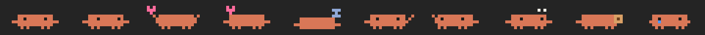

# Мини-Клод

[English](README.md) | **Русский**

Пиксельный краб Claude, который живёт поверх всех окон, гуляет по панели задач и окнам, сидит в трее, издаёт звуки и при желании помогает через [Claude Code](https://docs.claude.com/en/docs/claude-code).

<!-- TODO: добавить настоящую запись docs/demo.gif и раскомментировать:

-->



*Кадры отрисованы прямо из `animations.py`.*

> **Неофициальный фан-проект.** Не связан с Anthropic, не одобрен и не спонсируется ею. «Claude» — товарный знак Anthropic.

## Возможности

- Всегда поверх окон; гуляет по панели задач, залезает на окна и прыгает между ними, падает, если отпустить (простая физика).
- Реагирует на мышь: клик — прыжок с сердечками, поводить туда-сюда — мурчит, можно перетаскивать.
- Настроение и голод: можно покормить печенькой; голодный краб медленнее ходит и грустит.
- Спит, танцует, когда играет музыка, носит сезонные шапки (или выбранную: Санта, ведьма, колпак, корона, цилиндр).
- «Друзья» — разноцветные крабы, которые гуляют и машут Клоду.
- Напоминания (через N минут или ко времени) и помодоро (25 мин работы / 5 мин отдыха).
- Значок в трее (клик прячет и показывает), «Не мешать 1 час», автозапуск с Windows.
- Пиксельные звуки и озвучка реплик (голос Windows SAPI) по желанию.
- Всё настраивается: спрайты, анимации, фразы и шапки лежат в `animations.py`.

### По желанию: помощь через Claude Code

Нужен установленный [Claude Code](https://docs.claude.com/en/docs/claude-code) с выполненным входом: в терминале `claude`, затем `/login`. Питомец запускает `claude -p` в пустой временной папке, без ваших настроек и хуков, и разрешает только чтение картинки, поэтому ничего на компьютере не меняет.

- Спросить про активное окно (со скриншотом).
- Действия с выделенным текстом: перевести, исправить, вежливее, короче, объяснить; результат можно сразу вставить вместо выделенного.
- Спросить про область экрана; спросить голосом (голосовой ввод Windows).
- Реагирует на Claude Code (думает, пока Claude работает, радуется, когда готово, зовёт, когда нужен ответ) через небольшой хук, см. [ниже](#хук-для-claude-code).
- Окна с «банк», «пароль» и т. п. в заголовке никуда не отправляются.

## Управление

| Как | Что будет |
| --- | --- |
| Клик | подпрыгивает с сердечками |
| Поводить мышкой туда-сюда | мурчит (настроение растёт) |
| Перетащить | болтает ногами; отпустить — падает, может приземлиться на окно |
| Двойной клик или **Ctrl+Alt+C** | окошко «чем помочь?» по активному окну (со скриншотом) |
| **Ctrl+Alt+T** на выделенном тексте | перевести / исправить / вежливее / короче / объяснить |
| **Ctrl+Alt+S** | обвести область экрана и спросить про неё |
| **Ctrl+Alt+V** | спросить голосом |
| ПКМ | меню: напоминания, помодоро, печенька, анимации, друзья, настройки, спрятать, закрыть |

Закрыть: крестик при наведении, ПКМ → «Закрыть», значок в трее или `stop-pet.bat`.

## Настройки

ПКМ → «Настройки»: гулять самому, залезать на окна, танцевать под музыку, разговаривать, говорить вслух, звуки, реагировать на Claude Code, подсказки по активному окну, сразу вставлять обработанный текст, всегда поверх окон, запускать вместе с Windows, шапка, перезагрузить анимации. Настройки, настроение и напоминания сохраняются в `%USERPROFILE%\.claude-pet\settings.json` (там же созданные звуки и значок трея).

## Запуск

**Готовый exe:** скачайте `ClaudePet.exe` на странице [Releases](../../releases) и запустите. Python не нужен. Файл не подписан, поэтому SmartScreen может показать предупреждение.

**Из исходников:**

```bat
git clone https://github.com/cyxar4uk/mini-claude.git
cd mini-claude
pip install -r requirements.txt
start-pet.bat
```

`start-pet.bat` запускает `pythonw pet.pyw` без окна консоли, `stop-pet.bat` закрывает.

Требования: Windows 10/11, Python 3.10+ (разрабатывалось на 3.12) с tkinter, Pillow; pywin32 по желанию (озвучка).

## Хук для Claude Code

Чтобы питомец реагировал на Claude Code, скопируйте `hooks/claude-pet-hook.py` куда-нибудь (например в `~/.claude/hooks/`) и подключите в `~/.claude/settings.json`:

```json
{
  "hooks": {
    "PreToolUse":   [{"matcher": "*", "hooks": [{"type": "command", "command": "python \"C:/путь/к/claude-pet-hook.py\" working", "timeout": 5}]}],
    "PostToolUse":  [{"matcher": "*", "hooks": [{"type": "command", "command": "python \"C:/путь/к/claude-pet-hook.py\" working", "timeout": 5}]}],
    "Stop":         [{"hooks": [{"type": "command", "command": "python \"C:/путь/к/claude-pet-hook.py\" done", "timeout": 5}]}],
    "Notification": [{"hooks": [{"type": "command", "command": "python \"C:/путь/к/claude-pet-hook.py\" attention", "timeout": 5}]}]
  }
}
```

Хук только записывает текущее состояние в `~/.claude/pet-state.json`, за которым следит питомец.

## Свои анимации, шапки и фразы

Правьте `animations.py` (рядом с `pet.pyw` или с `ClaudePet.exe`), затем ПКМ → «Настройки» → «Перезагрузить анимации».

## Сборка exe

```bat
pip install -r requirements.txt pyinstaller
build.bat
```

Выполняется `python -m PyInstaller --onefile --windowed --name ClaudePet --icon icon.ico pet.pyw`, затем `animations.py` копируется в `dist\`, чтобы exe подхватывал правки. Результат: `dist\ClaudePet.exe`.

## Файлы

| Файл | Назначение |
| --- | --- |
| `pet.pyw` | точка входа: главный цикл, меню, горячие клавиши, напоминания, помодоро, состояние Claude Code |
| `critter.py` | краб: отрисовка, физика, мышь |
| `animations.py` | палитра, пиксельные кадры, анимации, фразы, шапки |
| `ui.py` | облачко, окно помощи, диалог напоминания, выбор области экрана |
| `helper.py` | вопросы к Claude через CLI, скриншоты, действия с текстом |
| `winsys.py` | Windows API: окна, глобальные клавиши, буфер обмена |
| `sounds.py` | звуки и голос SAPI |
| `tray.py` | значок в трее |
| `settings.py` | сохранение настроек |
| `hooks/claude-pet-hook.py` | необязательный хук Claude Code |
| `start-pet.bat`, `stop-pet.bat`, `build.bat` | запуск, остановка, сборка |

## Лицензия

[MIT](LICENSE) © 2026 Илья Мельников ([@cyxar4uk](https://github.com/cyxar4uk))
